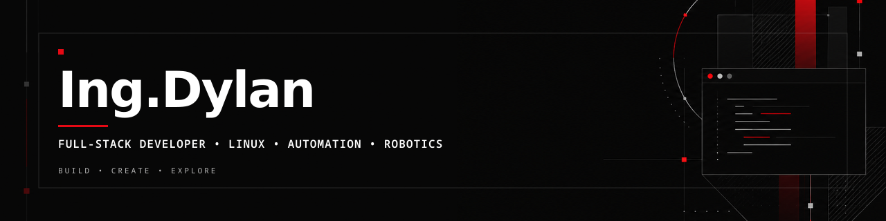
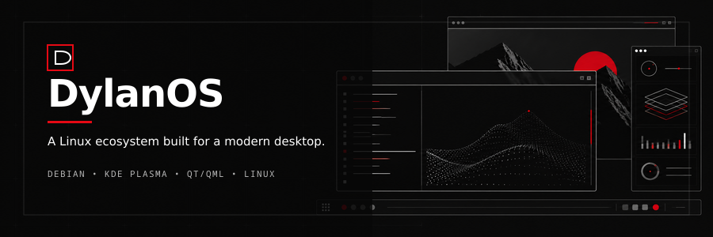
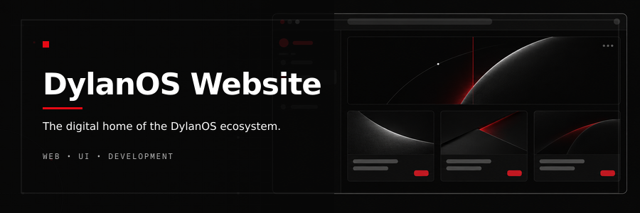
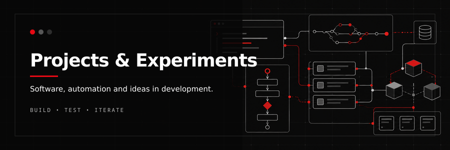
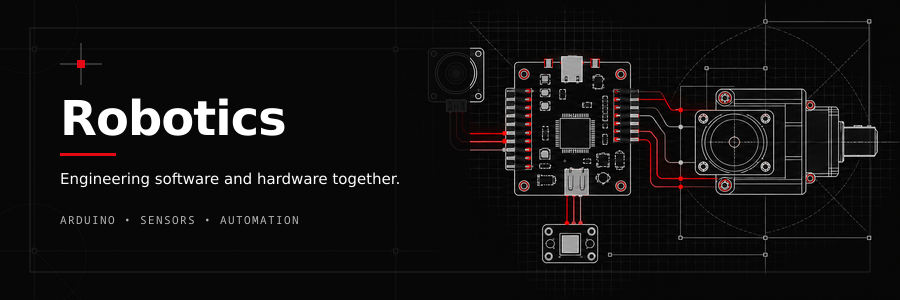
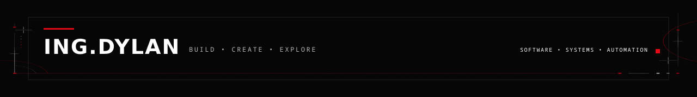

---

## 🧑‍💻 About Me

I'm **Ing.Dylan**, a developer and technology enthusiast focused on building practical software and experimenting with systems, automation and robotics.

* 💻 Full-Stack Development
* 🐧 Linux & Operating Systems
* 🤖 Automation & Robotics
* 🧠 AI & API Integration
* 🌐 Web Development
* 🎮 Minecraft & Digital Content

---

## 🚀 Currently Building

### 🐧 DylanOS

A Debian-based Linux distribution focused on a **modern, lightweight and coherent desktop experience**.

**Technologies:** Debian • KDE Plasma • Qt/QML • Linux



---

## 🛠️ Tech Stack

### Languages


### Frameworks & Runtime


### Databases


### Systems & Tools


---

## 📌 Featured Projects

<table>
<tr>
<td width="50%">

### 🐧 DylanOS

Linux distribution and desktop ecosystem.


</td>

<td width="50%">

### 🌐 DylanOS Website

Website and digital presence for DylanOS.



</td>
</tr>

<tr>
<td width="50%">

### ⚙️ Projects & Experiments

Tools, experiments and software projects.



</td>

<td width="50%">

### 🤖 Robotics

Arduino, electronics and robotics projects.



</td>
</tr>
</table>

---

## 📊 GitHub Activity

[PLACEHOLDER — GITHUB STATS IMAGE]

[PLACEHOLDER — TOP LANGUAGES IMAGE]

[PLACEHOLDER — CONTRIBUTION GRAPH]

---

## 🧠 What I Like Building

```text
Software
├── Web Applications
├── APIs
├── Automation
└── AI Integrations

Systems
├── Linux
├── Desktop Environments
├── Operating Systems
└── System Customization

Hardware
├── Arduino
├── Robotics
├── Sensors
└── Embedded Projects
```

---

## 🎯 Goals

* 🚀 Build and publish useful software
* 🐧 Develop DylanOS into a complete ecosystem
* 🧠 Explore AI-powered applications
* 🤖 Create increasingly advanced automation systems
* 🌐 Improve my full-stack engineering skills
* 📦 Build projects that people can actually use

---

## 🌐 Find Me

[PLACEHOLDER — SOCIAL LINKS / CONTACT BANNER]

**GitHub:** `@dylanneymarmontalvo2014-lgtm`

---

## ⚡ Fun Fact

> I like taking complicated systems apart, understanding how they work, and building my own version.

---


